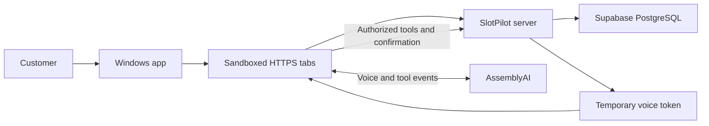

# SlotPilot for Windows

**An English-language desktop client for AI-assisted car service booking.**

SlotPilot helps a customer choose services, describe time and budget constraints, compare suitable appointments, and explicitly confirm a booking. The Windows app runs in its own window and connects to the existing SlotPilot service over HTTPS.

**Current desktop version: 0.3.2 · Windows x64.**

[Download the Windows installer](https://github.com/NuraliKuzhagaliev/SlotPilot-app/releases/download/v0.3.2/SlotPilot-0.3.2-Setup-x64.exe) · [Download the portable app](https://github.com/NuraliKuzhagaliev/SlotPilot-app/releases/download/v0.3.2/SlotPilot-0.3.2-Portable-x64.exe) · [All releases](https://github.com/NuraliKuzhagaliev/SlotPilot-app/releases)

## What the app does

- Opens **Home**, **Book a visit**, **Admin**, and **Demo** in separate tabs within one desktop window.
- Switches tabs immediately, without confirmation popups or reloading the previous booking form.
- Provides an English voice assistant and a **Type instead · hear replies** mode through the connected service.
- Shows the selected vehicle, services, date, branch, arrival window, completion deadline, and budget.
- Uses the existing server to find a compatible technician and bay, calculate duration and price, and check availability.
- Keeps final booking, rescheduling, and cancellation decisions on the server, with explicit confirmation and duplicate/conflict protection.
- Preserves the desktop sign-in session and window size between launches.
- Shows a local connection error screen and a **Try again** button when a page cannot load.
- Lets the user control microphone permission. Camera and screen capture are disabled.

Admin and demo actions require the appropriate server permissions. Opening a tab does not grant an administrative role. Workshop data and prices are demonstrative; the app is not an offer from a real workshop.

## Install and use

### Installer

1. Download `SlotPilot-0.3.2-Setup-x64.exe` from the release above.
2. Close an older running SlotPilot version, then run the installer.
3. Complete the English setup wizard. Installation is for the current Windows user and creates desktop and Start menu shortcuts.

### Portable version

Download and run `SlotPilot-0.3.2-Portable-x64.exe`. It includes the desktop runtime, so Node.js is not required on the user's laptop. Close an older running SlotPilot version first: a second launch focuses the already running instance.

The portable executable saves its sign-in session in the current Windows user profile. It does not carry that profile to another computer. Do not copy `SlotPilot.exe` alone from `win-unpacked`; that development output needs all its companion files.

### Start the assistant

1. Connect to the internet and open **Book a visit**.
2. Sign in with your SlotPilot account.
3. Enable the consent checkbox for sending messages and microphone audio to AssemblyAI.
4. Press **Start conversation**, allow microphone access, and speak English.
5. Review the proposed services, date, time, branch, and price before confirming the booking.

**Users do not need to enter an API key.** The existing server holds the permanent provider credentials and issues temporary voice tokens after authorization. Voice still depends on the provider's availability and existing account credits; the desktop app does not include a paid subscription or create one.

If Windows blocks the microphone, check the operating system's permission for desktop applications yourself. Windows-owned system dialogs use the operating system language; SlotPilot's own UI, menus, dialogs, and installer are English.

## Technologies

### Included in this repository

| Technology | Version / use |
| --- | --- |
| Electron | 44.5.1 — native Windows window, Chromium rendering, sessions and permission handling |
| JavaScript | CommonJS main/preload modules and browser scripts |
| HTML and CSS | Local tab bar, loading screen and connection recovery UI |
| BrowserWindow + WebContentsView | A local shell and a separate, sandboxed view for each section |
| electron-builder | 26.15.3 — Windows packaging |
| NSIS | Per-user installer and portable executable |
| Node.js test runner | Desktop access-policy tests |
| Real Electron smoke test | English UI, renderer isolation, tabs, document preservation and reconnect checks |

### Used by the connected SlotPilot service

| Technology | Responsibility |
| --- | --- |
| Next.js App Router | Server routes and the hosted application |
| React, TypeScript, Tailwind CSS | Booking, admin and demo interfaces |
| Supabase PostgreSQL | Persistent bookings, revision checks, transactions and resource conflicts |
| Supabase Auth | Account sign-in and server-checked roles |
| AssemblyAI Voice Agent API | English voice conversation and tool calls |
| AudioWorklet / PCM | Microphone capture and streamed audio playback |
| Vercel | The HTTPS deployment used by this client |
| Vinext | The existing service's alternative Sites hosting build |

**This repository contains the desktop client.** The connected service's backend and web-interface sources are maintained separately in the existing SlotPilot project. Installing this repository does not create or self-host a Supabase database or an AI server.

## Architecture



The local shell manages tabs and native controls. Each section is created on first use and retained when another tab becomes active. Switching tabs does not unload the original document. **Reload** affects the active tab and resets its unsaved client state; closing the window closes all tabs and audio connections.

The server remains responsible for business rules, roles, ownership checks, exact consent evidence and booking persistence. Audio interruption does not undo a database commit. If a connection fails after confirmation, reconnect and check the saved result before attempting the booking again.

The configured service origin is [slotpilot-beta.vercel.app](https://slotpilot-beta.vercel.app). This is an online client: internet is required for account access, the shared calendar and the AI assistant. Offline pages do not create local bookings.

## Development

Use Node.js 22.20.0, the version used for local verification. This repository has its own `package-lock.json`; it does not modify the connected service's pnpm dependencies.

```powershell
git clone https://github.com/NuraliKuzhagaliev/SlotPilot-app.git
cd SlotPilot-app
npm ci
npm test
npm run check
npm start
```

`npm ci` downloads the Electron runtime and development tools. No provider API keys are required to run this desktop client against the configured existing service. Account authentication and microphone consent remain required for voice use.

### Build Windows executables

Run on Windows:

```powershell
npm run build:win
```

Outputs:

```text
release/
  SlotPilot-0.3.2-Setup-x64.exe
  SlotPilot-0.3.2-Portable-x64.exe
  win-unpacked/
```

Builds are unsigned. Code signing and Windows SmartScreen reputation have not been established. The installer uses per-user installation and does not request administrator privileges.

### Publish a Windows release

For future versions, update `package.json` and `package-lock.json` together, merge the changes, then push a matching tag (for example, `v0.3.3` for version `0.3.3`). The **Build Windows app** workflow runs on `windows-latest`, installs dependencies with `npm ci`, runs tests and syntax checks, and builds both executables. A tag/version mismatch stops the build before publication.

After a successful build, the workflow attaches Setup, Portable, and `SHA256SUMS-<version>.txt` to the release for that tag. It creates the release with generated notes if one does not exist; existing release notes are preserved. Rerunning the tagged workflow replaces assets with the same names, including their checksums.

Use **Actions → Build Windows app → Run workflow** for test builds on a selected branch or tag. Manual runs keep the executables and checksums as a seven-day Actions artifact and do not publish a release.

### Run the integration smoke test

```powershell
node_modules/.bin/electron.cmd test/smoke.cjs
```

This opens the real app with a separate profile under `test-output/`. It loads the configured public server, tests renderer isolation, switches tabs, checks retained document state, deliberately blocks requests to exercise recovery, and verifies English labels. It does not enter credentials, create bookings, activate the microphone, or call the voice provider. Desktop access and an available internet connection are required.

### Repository layout

```text
src/
  main.cjs          Window, tabs, permissions, menus and validated IPC
  policy.cjs        Trusted origin, route and media-permission rules
  preload.cjs       Restricted bridge for the local shell only
  navigation.js     Cross-section links routed into desktop tabs
  shell.html        English desktop shell
  shell.css         Desktop styles
  shell.js          Tab controls and connection-state rendering
assets/             Application icons
test/               Policy tests and real-Electron smoke test
docs/               Installation guide and release checksums
.github/workflows/  Source checks, tagged Windows releases and manual test builds
package.json        Runtime entry point and packaging configuration
package-lock.json   Pinned desktop dependencies
```

To use a different self-hosted service, configure and verify that service separately, update the HTTPS origin in `src/policy.cjs`, and rebuild the client. The allowed origin is deliberately explicit; arbitrary URLs cannot be opened with desktop privileges.

## Security and data

- Permanent AssemblyAI and database keys are kept on the server and are not bundled in the executable.
- Remote pages use `sandbox: true`, `contextIsolation: true`, `nodeIntegration: false` and no preload bridge.
- TLS, web security and same-origin protections remain enabled.
- Native IPC accepts only the trusted local shell's main frame and a fixed set of commands.
- Navigation and microphone permission checks use the exact trusted HTTPS origin.
- Microphone permission requires an explicit user decision and accepts audio only from a trusted main frame.
- The Chromium profile stores session cookies under the current Windows user's application data directory. Do not publish or share that profile.
- Dependencies, generated executables, test profiles and environment files are excluded from Git. Release executables are shared through GitHub Releases.

## Verification and current limits

For version 0.3.2, local checks passed:

- 6 desktop access-policy tests and JavaScript syntax checks.
- Real Electron smoke checks for English UI/menus/browser language, HTTPS page loading, isolated remote rendering, native resize, blocked foreign popups, tabs with retained document state, background-error isolation and reconnect/reload.
- Windows installer and portable packaging; packaged sources match the checked desktop sources.
- The connected project's separate 234 automated tests and TypeScript checks passed locally. Its Next.js production build previously passed. Those backend tests are not included in this desktop-only repository.

The public service reported account, database and voice configuration present on 30 September 2026. This confirms configuration presence, not credential validity, provider balance or a successful live voice conversation.

**Still unverified in the desktop client:** real account login, a physical microphone/speaker conversation, audible interruption latency, and a complete voice booking saved to PostgreSQL and read after restarting. Full P0 acceptance is not claimed. Recent real-database tests in the connected project were blocked by missing local configuration; previous PostgreSQL concurrency checks are documented in that project separately.

See the [installation guide](docs/INSTALL_WINDOWS_EN.txt) and [SHA-256 checksums](docs/SHA256SUMS-0.3.2.txt). Rebuilt artifacts can have different checksums; the listed values apply to the uploaded 0.3.2 executables.
